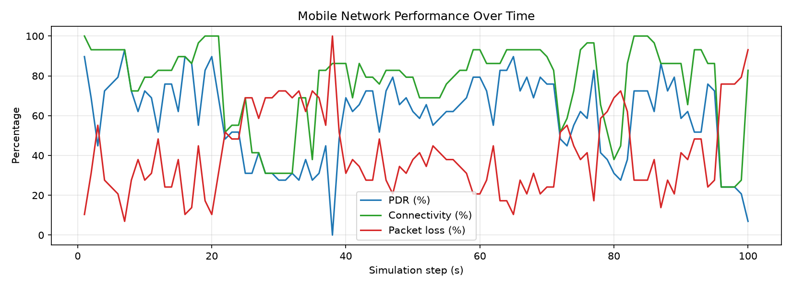

# Mobility-Aware WSN Reliability Predictor

A software-only simulation of a **Wireless Sensor Network (WSN)** with moving sensor nodes. It measures how node mobility affects connectivity, packet delivery, packet loss and delay, and uses **machine learning** to predict which wireless links are likely to fail.

> No hardware needed — everything is simulated in Python.

| Area | What it does |
| --- | --- |
| Simulation | 20–50 virtual sensor nodes in a 200 m × 200 m area with one fixed sink |
| Mobility | Random Direction model, speed adjustable live from 0 to 20 m/s |
| Communication | Distance-based radio model (RSSI, link quality), multi-hop routing, IEEE 802.15.4-style retries |
| Metrics | Packet delivery ratio, packet loss, end-to-end delay, connectivity, reliability index |
| Machine learning | Decision Tree predicts link failure, with accuracy, confusion matrix and learned rules |
| Dashboard | Streamlit app with live topology map, controls, graphs and gauges |

**Stack:** Python · NumPy · pandas · NetworkX · scikit-learn · Matplotlib · Plotly · Streamlit

## Quick start

```bash
cd Mobility_Aware_WSN
python -m venv .venv
.venv\Scripts\activate          # macOS/Linux: source .venv/bin/activate
pip install -r requirements.txt
streamlit run dashboard.py       # interactive dashboard
python main.py                   # full experiment, saves results/
```

Full documentation, architecture and results: **[Mobility_Aware_WSN/README.md](Mobility_Aware_WSN/README.md)**



---

Built by [Katrine Daniel](https://github.com/katrine-daniel).
